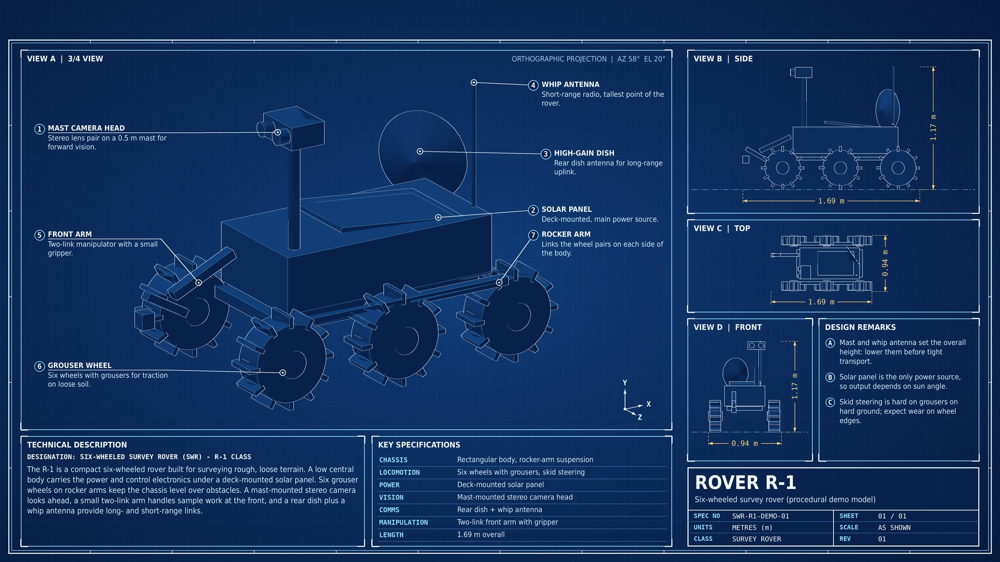
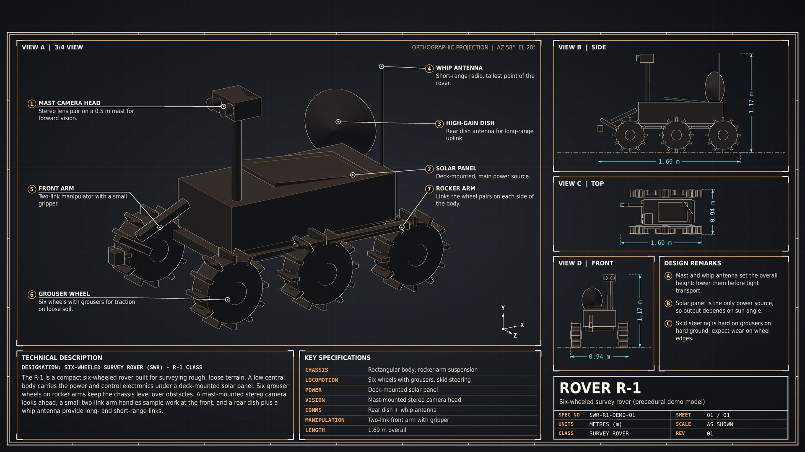
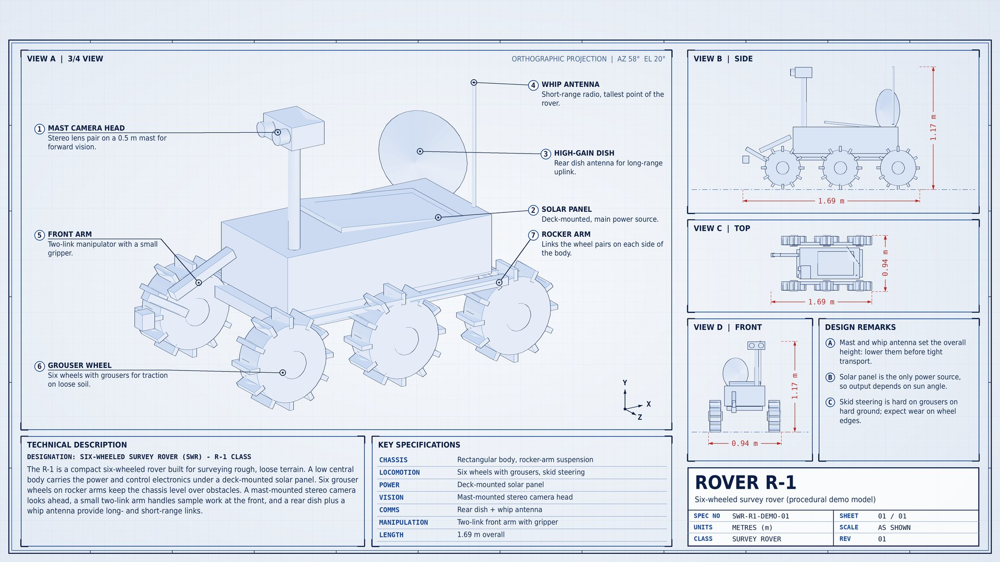
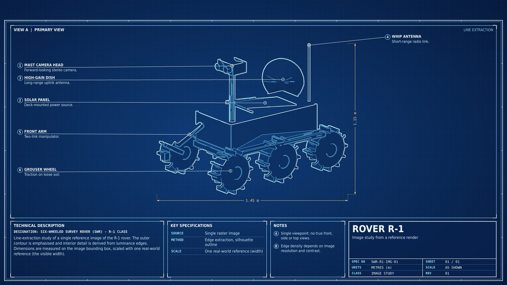

# blueprint-maker

 

Turns a 3D model (GLB, glTF, OBJ, STL, PLY, OFF) or a 2D image into a technical blueprint sheet (PNG, 1920x1080 by default): hidden-line views, dimension lines, numbered callouts, description, spec table and title block. Works as a [Claude skill](#as-a-claude-skill) or as a standalone command-line tool ( the claude skill way is recommended for a slightly better result).



- **3D model:** large 3/4 view plus side, top and front views with measured dimensions.
- **2D image:** line extraction with silhouette outline, bounding-box dimensions and callouts (single view only).
- **Callouts:** label positions are chosen automatically; a layout audit reports overlaps and crossing leaders.
- **Reproducible specs:** a lockfile binds each spec to the model it was written for and fails loudly if the model, orientation or view changes.
- **Output:** three palettes (`blueprint`, `graphite`, `paper`), any 16:9 resolution, configurable top safe zone for desktop bars.

## Requirements

Python 3 (developed on 3.12).

```bash
pip install trimesh numpy scipy networkx pillow opencv-python-headless matplotlib
# optional, only for meshes above ~700k faces:
pip install fast-simplification
```

## Quick start

The repo ships a procedural demo model (no third-party assets), so you can run it right away:

```bash
python3 scripts/blueprint3d.py build assets/demo/demo_rover.glb assets/example_spec_3d.json --out blueprint.png
python3 scripts/blueprint2d.py build assets/demo/demo_image.png assets/example_spec_2d.json --out blueprint2d.png
```

## Usage

```bash
# 3D model: inspect once (orientation + numbered anchor candidates), write a spec, build
python3 scripts/blueprint3d.py inspect model.glb --out insp
python3 scripts/blueprint3d.py build model.glb spec.json --out blueprint.png

# 2D image
python3 scripts/blueprint2d.py inspect image.png --out insp
python3 scripts/blueprint2d.py build image.png spec.json --out blueprint.png
```

`inspect` writes a single `inspect.png` to find the model's up/front axes (`--up`, `--front`) and the anchor candidates used by `"cand"` in the spec. Use `--front=-X` (with `=`) for negative axes.

Minimal 3D `spec.json`:

```json
{
  "title": "My Object",
  "subtitle": "Short subtitle",
  "description": "Two or three sentences describing what is visible in the render.",
  "specs": [["Material", "Alloy"], ["Drive", "Electric"]],
  "notes": ["First remark.", "Second remark."],
  "callouts": [
    {"title": "Front sensor", "desc": "One short sentence.", "cand": 1},
    {"title": "Rear module", "desc": "One short sentence.", "cand": 13}
  ]
}
```

Useful keys: `width`/`height`, `top_safe`, `palette`, `up`/`front`, `view` (`az`/`el`), `layout` (`multi`/`single`), `scale_ref` (a real-world measurement, to get real units in the dimensions). Without `scale_ref`, dimensions are in model units (`u`) or pixels (`px`). Full reference in [`SKILL.md`](SKILL.md).

Painted views are cached in `~/.cache/blueprint-maker` (or `$BP_CACHE`), so editing text or callouts rebuilds in seconds. Use `--no-cache` to disable.

## Spec lock

Anchors given as `cand`, `pick` or `extreme` only make sense for the model, orientation and view they were chosen on. The first build writes `<spec>.lock.json` with the 3D point each anchor resolved to, a geometric fingerprint of the model and the settings that affect anchors. Later builds compare against it:

- anchors moved (different model, orientation or view): the build **fails** and names each affected callout and what changed;
- model differs but anchors still land in the same place (e.g. a lossless re-export): warning;
- you edited an anchor on purpose: the lock entry is updated.

After re-inspecting, accept the new state with `--relock`. `--no-lock` skips the check. Commit the lock file together with the spec.

## Examples

All generated from the procedural demo rover (`assets/demo/make_demo_assets.py`).

| Graphite palette | Paper palette (printable) |
|---|---|
|  |  |

2D image pipeline (single view, one real-world reference for scale):



## Tests

```bash
python3 tests/test_binding.py
```

Checks that a saved spec either stays attached to the intended features or fails explicitly when the model is replaced, re-oriented or viewed differently, and that `--relock` / `--no-lock` behave.

## As a Claude skill

Install the packaged `blueprint-maker.skill` file (or copy this folder into your skills directory). Claude then runs the workflow above whenever you ask for a blueprint, technical drawing or technical wallpaper of a model or image.

## Limitations

- A 2D image has one viewpoint: no real front/side/top views. Use a 3D model for those.
- Line density depends on the mesh or image; very dense game meshes give busy lines.
- Dimensions are not real-world unless `scale_ref` is given.
- `cand` anchors are coverage points on the visible surface, not recognised parts: check that each dot lands on the part its label names.
- Text rendering covers Latin, Greek and Cyrillic only. The layout is designed for 16:9.
- The 2D background mask works for flat or transparent backgrounds; otherwise supply `"bg": "none"`, a crop, or a mask image.

## Project structure

```
blueprint-maker/
├── SKILL.md              # skill instructions + full spec reference
├── scripts/
│   ├── blueprint3d.py    # 3D CLI (inspect, build)
│   ├── blueprint2d.py    # 2D CLI (inspect, build)
│   ├── hlr.py            # hidden-line renderer, render cache
│   ├── binding.py        # spec lockfile (fingerprint + anchor drift check)
│   └── bp_common.py      # layout, drawing, label placement and audit
├── assets/
│   ├── demo/             # procedural demo model + generator script
│   └── example_spec_*.json
├── docs/examples/        # sample output images
└── tests/test_binding.py
```

## License

MIT. Models and images you convert remain subject to their own licenses; do not redistribute assets you do not own.
